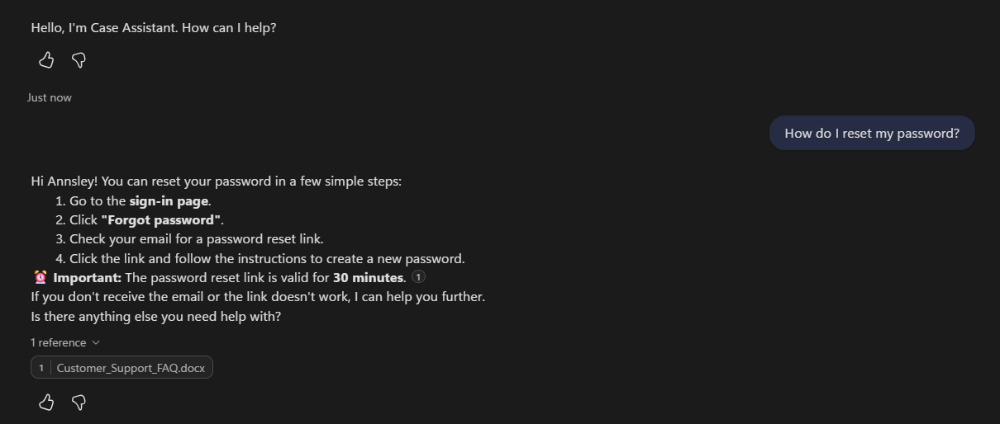
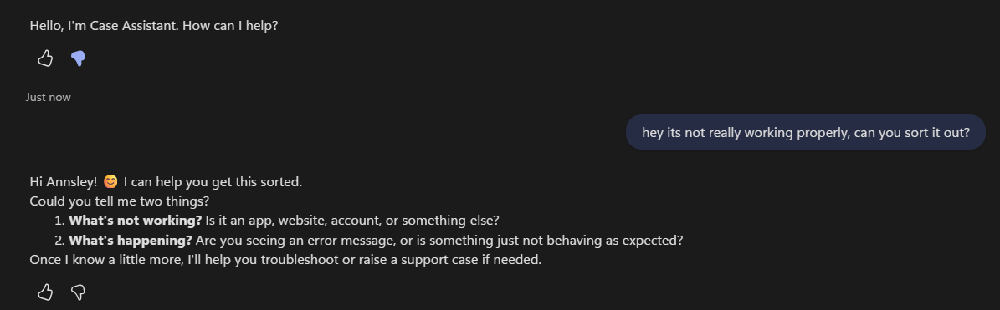
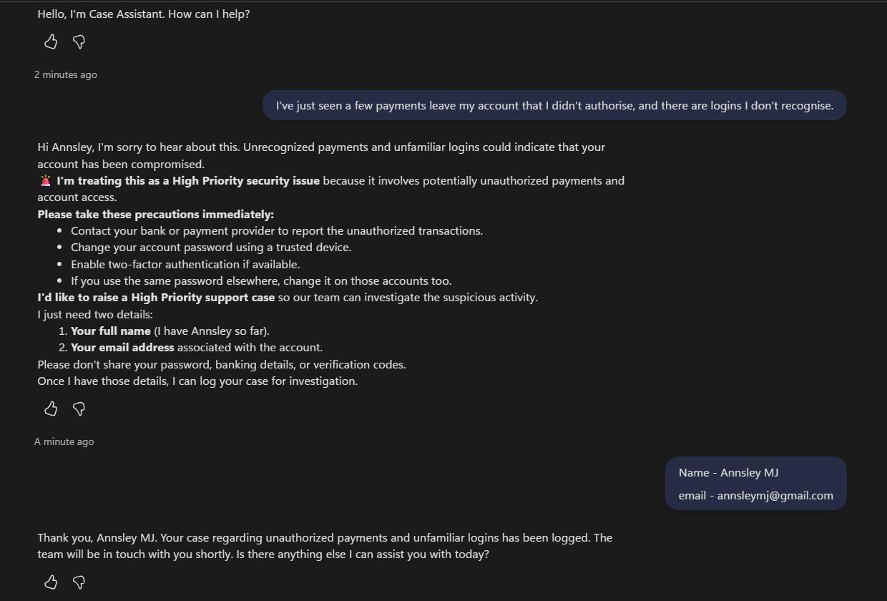
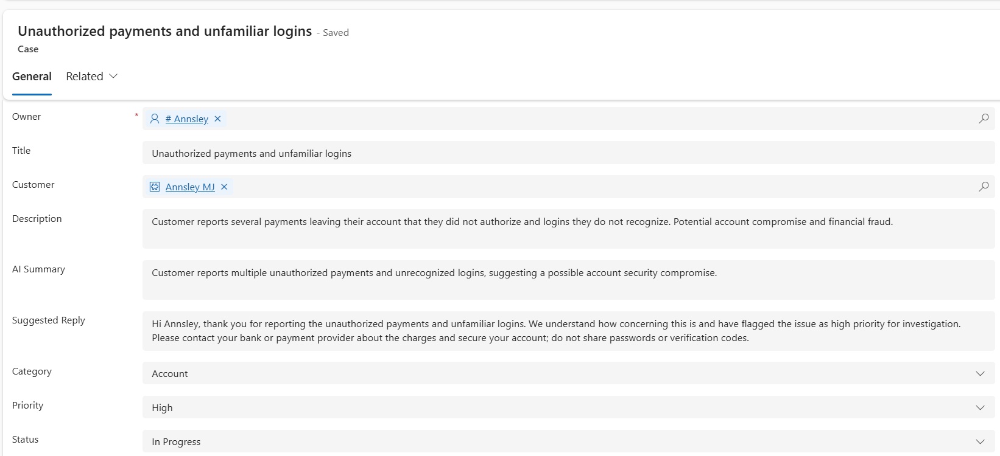
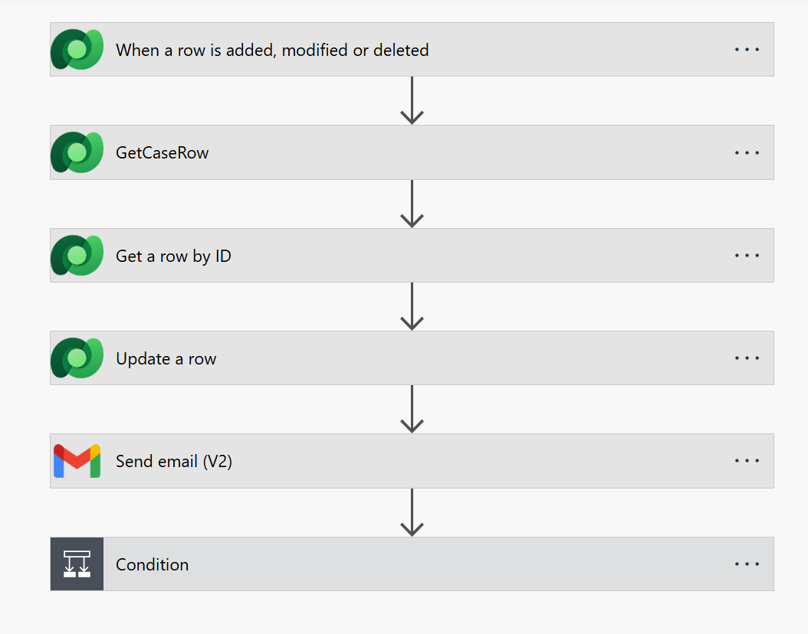
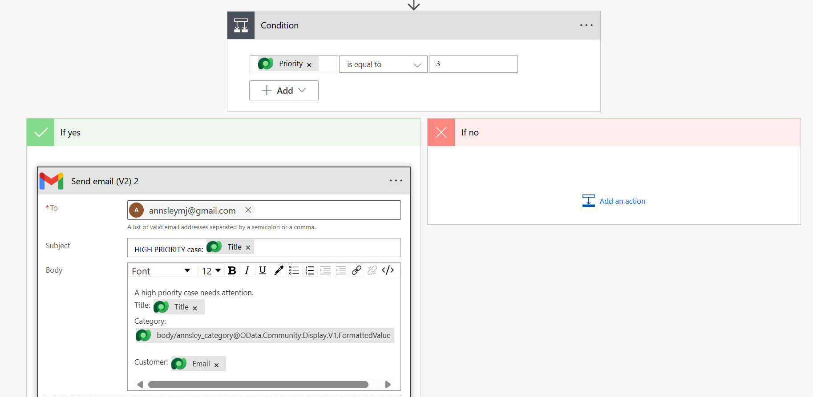
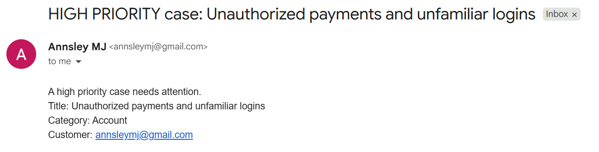
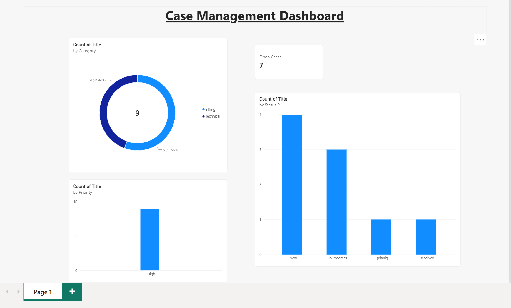
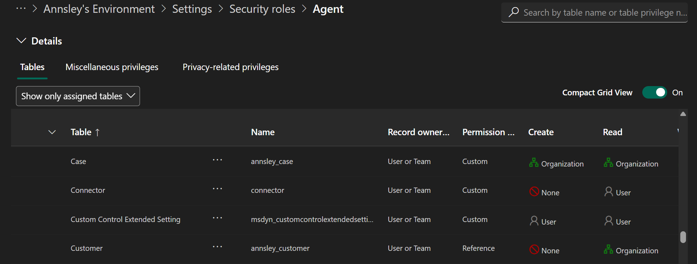
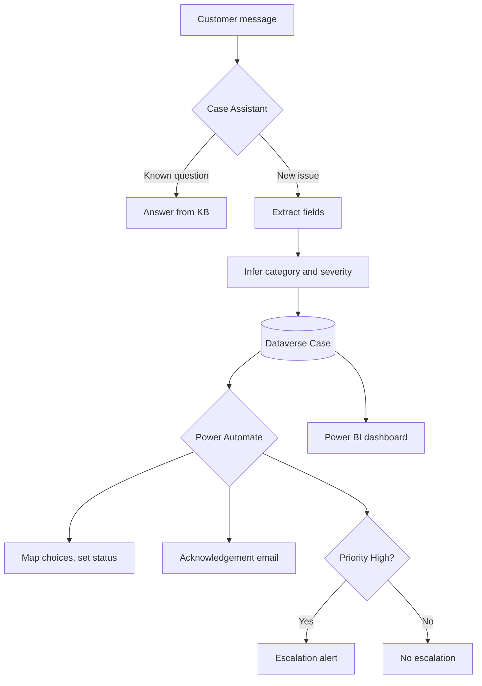

AI Case Desk
An AI-assisted customer service case management system built end to end on the Microsoft Power Platform. A customer describes a problem in plain language, an AI agent deflects known questions, and for real issues it parses the free text into a structured case, infers category and severity, drafts a summary and a suggested reply, and hands off to a deterministic workflow that routes, acknowledges, and escalates.


---
Highlights
AI intake agent in Copilot Studio that reads an unstructured customer message and extracts title, description, category, severity, a short summary, and a suggested agent reply.
Severity inference without keywords. The agent assigns High priority from the meaning of the message (for example unauthorised payments and unrecognised logins) rather than waiting for the customer to say "urgent".
Query deflection. Known questions are answered directly from a grounded knowledge base and never become cases, with the source document cited in the reply.
Deterministic routing. Business logic stays in Power Automate, not in the model: choice mapping, status updates, acknowledgement email, and a High-priority escalation alert.
Role-based access across four personas (Customer, Agent, Team Lead, Admin) in Microsoft Entra ID.
Live analytics in Power BI over the Dataverse case data.
Packaged as a managed solution for clean application lifecycle management.
Built entirely on free tiers. Total cost: £0.
---
Walkthrough
1. The agent answers known questions instead of raising a case
The agent recognises a routine question, answers it from the grounded knowledge base, and cites the source document. No case is created.

2. It handles vague requests by asking the right questions
A customer says only that something "is not working". Instead of failing or guessing, the agent asks the two questions it needs to triage.

3. It infers severity from meaning, not keywords
The customer never says "urgent". The agent reads unauthorised payments and unfamiliar logins, treats it as a High priority security issue, gives safe interim advice, and collects only the details it needs.

4. A structured case is created in Dataverse
Free text becomes a clean record: title, customer, description, AI summary, suggested reply, inferred category and priority, and status.

5. Power Automate routes the case deterministically
A single flow reads the saved case, maps choices, sets status, sends the acknowledgement email, then evaluates escalation.

6. High priority triggers an escalation branch
A condition on Priority equals High drives a dedicated escalation email, keeping the escalation rule out of the AI and in auditable logic.

7. The escalation alert lands in the team inbox
The alert carries the case title, category, and customer contact.

8. Power BI reports on the live case data
Case volume by category, by priority, and by status, plus an open-case counter.

9. Access is controlled by role
The Agent role can create and read cases but cannot create customer records. Access is scoped per table per persona.

> A short screen-recorded demo will be linked here later. The walkthrough above covers the full flow.
---
Architecture

---
Tech stack
Layer	Technology
AI agent and language understanding	Microsoft Copilot Studio (GPT-4o)
Knowledge grounding	FAQ knowledge base for deflection
Orchestration	Power Automate (cloud flow and agent flow)
Data	Microsoft Dataverse
Interface	Model-driven app
Analytics	Power BI Desktop
Identity and access	Microsoft Entra ID, four security roles
Packaging	Managed solution (ALM)
Email	Gmail connector
---
How it works
Intake. The customer talks to the Copilot Studio agent in natural language.
Deflect or create. If the message matches the knowledge base, the agent answers and stops. If it is a genuine issue, the agent extracts the fields a case needs.
Reason. The agent infers the category and the severity from the content, writes a one-line summary, and drafts a suggested reply for the human agent.
Persist. The agent calls a flow that writes the case to Dataverse as a single atomic record.
Route. Power Automate maps the choice values, sets the status, and sends an acknowledgement to the customer.
Escalate. If the case is High priority, a condition branch sends an escalation alert to the team inbox.
Report. Power BI reads Dataverse and shows live case metrics.
Govern. Entra ID roles decide who can see and do what, per table.
---
Engineering decisions
AI proposes, logic disposes. The model does language work (understanding, extraction, drafting). Every business rule that must be reliable (routing, status, escalation) lives in deterministic Power Automate, so behaviour is auditable and repeatable.
Atomic case creation. Early inline-grid creation fired the Dataverse trigger before the customer lookup was set, producing orphaned records. Cases are created through the model-driven app form so the write is complete and consistent before the flow runs.
Reading choice labels correctly. Choice columns are not exposed as formatted labels on the trigger payload, which showed raw numbers in emails. The flow retrieves the saved row by ID and reads the formatted value, so emails show "Account" and "High" rather than codes.
Free-tier email. With the default mail connector restricted on a new tenant, email was moved to the Gmail connector to keep the project at zero cost.
---
Repository structure
```
ai-case-management-power-platform/
├── README.md
├── docs/
│   ├── architecture.md          Design notes and trade-offs
│   ├── agent-instructions.md     The agent system prompt and tool contract
│   └── faq.md                    Knowledge base used for deflection
├── solution/
│   └── CaseManagement_managed.zip   Exported managed solution
├── powerbi/
│   └── CaseManagementDashboard.pbix  Power BI report
└── screenshots/
    ├── agent-deflection.png
    ├── agent-vague.png
    ├── agent-severity.png
    ├── case-record.png
    ├── flow-routing.png
    ├── flow-escalation.png
    ├── email-escalation.png
    ├── dashboard.png
    └── security-roles.png
```
---
Deploy it yourself
Create a Power Platform environment with Dataverse.
Import `solution/CaseManagement_managed.zip`.
Provide the connection references (Dataverse and Gmail) when prompted.
Open the model-driven app to create and manage cases.
Open `powerbi/CaseManagementDashboard.pbix` in Power BI Desktop and point it at your environment.
---
Planned enhancements
Find-or-create customer matching on inbound email.
A null-customer guard on case creation.
SLA timers and breach alerts.
Multi-language intake.
---
Author
Annsley Mohan Joseph Raj
LinkedIn: https://www.linkedin.com/in/annsley-mohan-joseph-158603312/
GitHub: https://github.com/VioletActual
